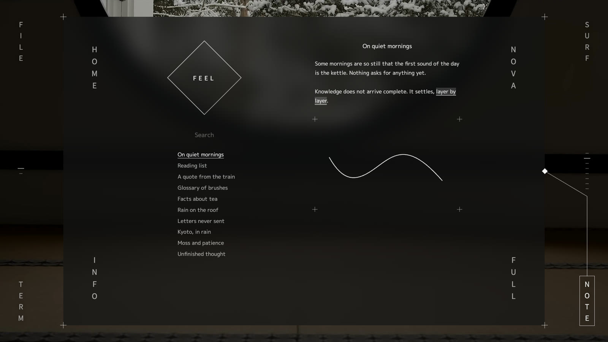
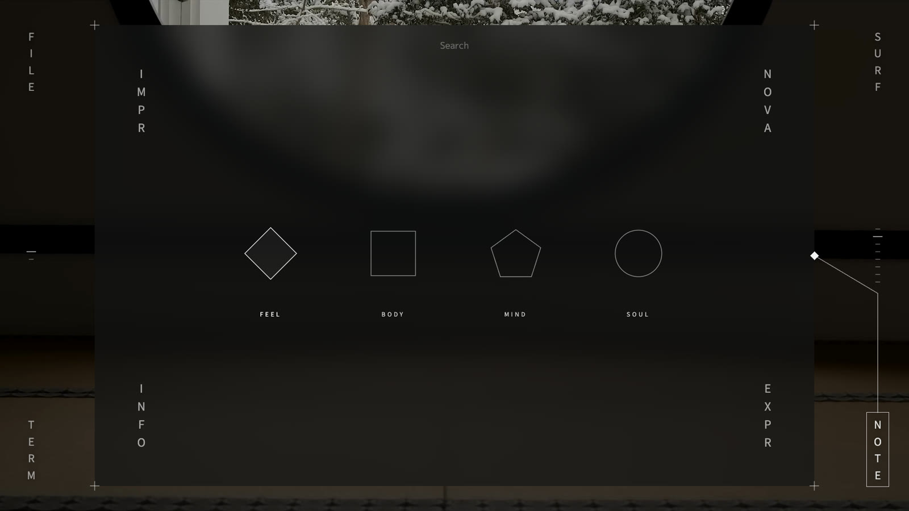
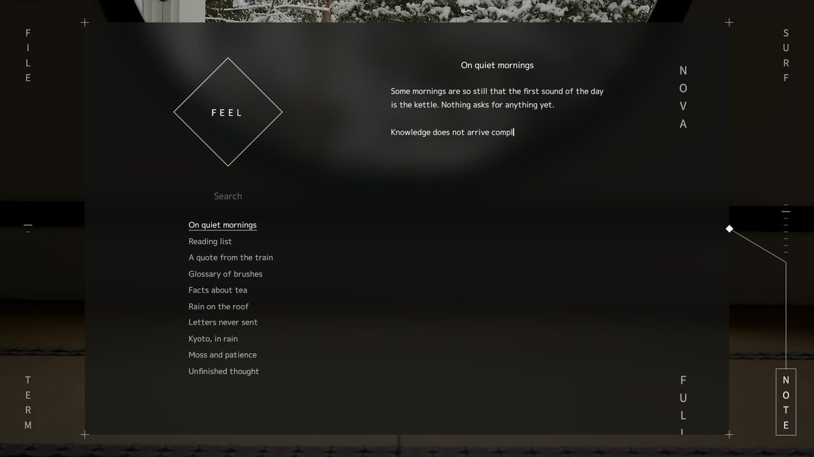

<div align="center">
  
  <h1>re: note</h1>
  <p><em>Thoughts, in four rooms</em></p>
  <p>Just notes, in four quiet rooms.</p>
  <p><a href="https://getrespace.app/download/ReSpace.dmg">Download for Mac</a> · <a href="https://getrespace.app">getrespace.app</a> · <a href="https://ko-fi.com/artursavytskyi">Support</a></p>
</div>

**re: note** keeps notes in four rooms: Feel, Body, Mind and Soul. Write, draw between the words, mark what matters, and find anything again. Everything stays on this Mac.

<p align="center">
  <a href="https://getrespace.app">
    
  </a>
</p>

<details>
  <summary>📸 More pictures</summary>

| The four rooms | Writing |
| --- | --- |
|  |  |

</details>

## What it does

- **Four spaces**: Feel, Body, Mind and Soul: four rooms for notes.
- **Drawings**: Drawn between the words of a note (⌘D).
- **Highlights**: A passage marked with ⌘B.
- **Search**: Through every note, in every space.
- **Private**: The notes stay on this Mac, nowhere else.

## Part of re: space

re: note is one of five quiet apps for the Mac. Each is fine alone; all five together make one quiet desk.

| | App | |
| :---: | :--- | :--- |
|  | [**re: desk**](https://github.com/artyr1997/ReDesk) | the desk they live on |
|  | [**re: file**](https://github.com/artyr1997/ReFile) | files, and what is in them |
|  | [**re: surf**](https://github.com/artyr1997/ReSurf) | a browser that stays out of the way |
|  | [**re: term**](https://github.com/artyr1997/ReTerm) | a terminal that reads like a conversation |
|  | [**re: note**](https://github.com/artyr1997/ReNote) *(this one)* | notes, in four quiet rooms |

## Install

Download **[ReSpace.dmg](https://getrespace.app/download/ReSpace.dmg)** from [getrespace.app](https://getrespace.app): all five apps, signed and notarized by Apple, so they open without a warning. Open it and drag each app into **Applications**.

Native Swift and AppKit. Runs on **macOS 13 Ventura or later**, on Apple silicon and Intel (one universal app).

## Keys

**Notes**

| Key | Does |
| :--- | :--- |
| ⌘N | new window |
| ↑ / ↓ | select a note |
| ← / → | another space |
| N | new note |
| E / ↩ | edit |
| / or ⌘F | search |
| ⌫ | delete |
| Esc | home |

**A note**

| Key | Does |
| :--- | :--- |
| ⌘S | save |
| Esc | back |
| ⌘B | highlight |
| ⌘D | draw |
| ⌘Z | undo |
| ⇧⌘Z or ⌃Y | redo |

**Drawing**

| Key | Does |
| :--- | :--- |
| drag | draw |
| ⌥ drag | rub out |

With [re: desk](https://github.com/artyr1997/ReDesk) running, every key here can be set to your own in its keys sheet (⌘/).

## Build from source

With Xcode's command-line tools (Swift 5.9 or later) on macOS 13 or later:

```bash
./build.sh             # build/ReNote.app, universal (arm64 + x86_64)
./build.sh --install   # and into Applications
```

`build/ReNote.app/Contents/MacOS/ReNote --render <folder>` draws its views into pictures, from made-up data.

How it is made, in detail: [docs/DETAILS.md](docs/DETAILS.md).

## Support

re: space is made by one person, slowly and with care. If it makes your days a little calmer, you can [buy me a coffee on Ko-fi](https://ko-fi.com/artursavytskyi).

## License

[MIT](LICENSE) © 2026 Artur Savytskyi. Security reports: see [SECURITY.md](SECURITY.md).
